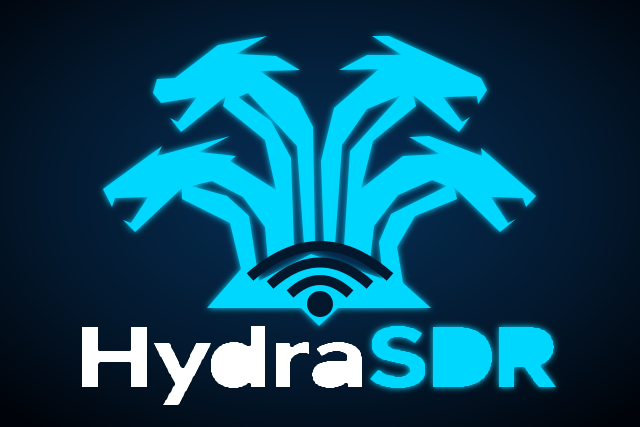

# HydraSDR

<p align="center">
  
</p>

HydraSDR is an experimental software-defined radio driver and firmware project
for MediaTek MT7921/MT7961-class Wi-Fi hardware. It extends these commodity
radios beyond their normal Wi-Fi role with native I/Q capture, coherent dual-RX,
bounded arbitrary-I/Q transmit experiments, coherent same-channel 2TX and
low-level MT79xx PHY/RF instrumentation.

The principal development target is the **MT7921AUN / MT7961 architecture family
with MT7972 RF companion**, validated primarily on the Fenvi AX1800 adapter.
The Fenvi device is sold as an MT7921AUN design, while its digital/baseband core
identifies and behaves as the MT7961-family implementation used by the current
HydraSDR firmware and register backend.

HydraSDR is derived from [BirriaSDR](https://github.com/luigifcruz/BirriaSDR),
whose MT7921 user-space SDR architecture, USB transport, receiver API and
firmware provided the foundation for this work. See [Credits](#credits) and
`NOTICE` for full attribution.

> **Status:** research software. RX is the mature path. TX support is explicitly
> gated, bounded and intended for shielded RF-lab use. RF output power is not
> calibrated and HydraSDR does not claim regulatory compliance.

## Hardware support

HydraSDR is structured around chipset-specific backends. A recognized USB ID is
**not** by itself a statement that every board using that ID has identical RF
routing, filters, calibration data or antenna topology.

### Implemented chipset family

The current functional backend targets the **MT7921AUN / MT7961 firmware and
baseband architecture family with MT7972 RF companion**. On the devices we have
reverse-engineered, MT7921AUN products expose the same MT7961-family digital
architecture, firmware conventions and register model that HydraSDR uses.
Accordingly, HydraSDR treats MT7921AUN and MT7961 as one closely related backend
family rather than unrelated chip targets.

The backend covers the custom firmware/boot path, I/Q capture, tuning, gain,
filter control, diagnostics and the currently qualified experimental TX path.
Board-specific RF routing, filters and calibration still vary independently of
that shared digital architecture.

### Tested and recognized hardware

| Hardware | USB ID | Status | Qualification |
| --- | --- | --- | --- |
| **Fenvi AX1800 / MT7921AUN + MT7972** | `0e8d:7961` | **Primary development target** | Current RX, 2RX, experimental TX, coherent same-channel 2TX and simultaneous 2TX+2RX work is physically validated on this device. Its digital core follows the MT7961-family firmware/register architecture used by the backend. |
| **COMFAST MT7961/MT7972 USB adapter** | `3574:6211` | Supported | Original/upstream receiver target and supported by the implemented MT7961/MT7972 backend. Current advanced TX qualification is not claimed for this board. |
| **EDUP AX3000/AX3000M-class MT7961/MT7972 adapter** | `0e8d:7961` | Supported with board-specific limits | RX/gain work has been exercised on this board family. The current conservative generic-ID tuning floor is 2.19 GHz because one tested EDUP unit did not calibrate reliably below that region. |
| Generic MT7961/MT7972 board | `0e8d:7961` | Recognized / provisional | Uses the implemented backend, but board-specific RF wiring and calibration must be qualified before assuming Fenvi-equivalent behavior. |
| MT7925 USB | `0e8d:7925` | Discovery only | Recognized so HydraSDR can identify it safely; no functional SDR backend yet. |
| Netgear A8500 / MT7925 | `0846:9050` | Discovery only | No RX/TX support yet. |
| Netgear A9000 / MT7925 | `0846:9072` | Discovery only | No RX/TX support yet. |

### Scope beyond the current hardware

HydraSDR is intentionally not designed as a one-dongle project. The common USB,
streaming and application layers are separated from chipset-specific boot, RF,
PHY and capture logic so additional backends can be added without pretending
register maps are portable across chips.

Near-term expansion targets are other MediaTek families where architecture and
firmware knowledge can be established rigorously, including **MT7925 and MT799x**.
Longer term, the same host/API model could support suitable RF-capable devices
from other vendors. Those are project goals, **not current support claims**.

## Current capabilities

### Receive

- Native complex I/Q capture with signed 14-bit samples transported as `int16_t` I/Q.
- Single-RX capture at 10, 20, 40 and 80 MS/s nominal rates.
- Dual-RX capture at **2 × 40 MS/s** through the verified RAW2 interleaved path.
- Shared-LO coherent dual-RX observation suitable for relative-phase work.
- Live tuning, raw gain control, finite/asynchronous capture and recovery/error reporting.
- A HydraSDR SoapySDR module exposed as **`driver=hydra`** with CS16/CF32,
  dual-channel RX, native-rate selection, tuning/gain control, diagnostic
  sensors and stream-recovery handling.

### Experimental transmit

Current shielded hardware results include:

- finite source-dependent arbitrary-I/Q modulation through the N9 DMA → PHY
  scalar path, with approximately **4.086 MS/s RF-effective update rate** in the
  best qualified same-channel tests;
- **two physical same-channel TX paths active simultaneously** from one common
  I/Q source;
- coherent common-I/Q 2TX: across eight low-gain bounded runs, internal dual-RX
  observation measured approximately **0.56° circular mean relative phase**,
  **0.86° circular standard deviation**, and **0.99734–0.99998 coherence**;
- simultaneous coherent **2TX + 2RX**, with both RX lanes running at 40 MS/s
  during the bounded TX interval;
- independently programmable synthesizer state, a prerequisite for DBDC work;
- fresh host-to-device IQ ingress above 5 MS/s with RF disabled.

Important limits:

- same-channel 2TX currently shares a common I/Q source; arbitrary independent
  I/Q per antenna is **not** yet exposed;
- the second PHY context is being treated as a DBDC/second-PHY candidate rather
  than a second same-channel antenna-I/Q input;
- sustained fresh host → RF TX above the scalar-path rate is **not** yet solved;
- calibrated antenna-port power, EVM and communications-grade in-band
  full-duplex reception are not yet qualified;
- internal self-coupled RX measurements are useful for path/coherence work but
  are not a substitute for calibrated external RF instrumentation.

## Build

Linux requirements are a C11 compiler, CMake, pthreads and libusb-1.0
development headers. SoapySDR development files are optional.

```sh
git clone https://github.com/mbound/hydraSDR.git
cd hydraSDR
cmake -S . -B build -DBUILD_TESTING=ON
cmake --build build -j
ctest --test-dir build --output-on-failure
```

Disable the optional SoapySDR module explicitly with:

```sh
cmake -S . -B build -DHYDRASDR_SOAPY=OFF
```

Install the supplied udev rule as appropriate for the host:

```sh
sudo cp tools/99-hydrasdr.rules /etc/udev/rules.d/
sudo udevadm control --reload-rules
```

## Basic RX usage

List supported devices:

```sh
./build/hydra_rx --list
```

Capture single-channel CS16 I/Q at 40 MS/s around Wi-Fi channel 6:

```sh
./build/hydra_rx --frequency 2437000000 --rate 40000000 rx.cs16 4000000
```

Capture both verified RX lanes at 2 × 40 MS/s:

```sh
./build/hydra_dual_rx 2437000000 40000000 204800 rx0.cs16 rx1.cs16
```

The dual recorder currently uses the qualified 2.4-GHz shared-LO configuration.
New applications should use the public C API in `include/hydrasdr.h`.

## SoapySDR

When SoapySDR development files are available, the build produces the HydraSDR
module with driver key `hydra`.

After building, a local module can be discovered with:

```sh
SOAPY_SDR_PLUGIN_PATH=$PWD/build/soapy SoapySDRUtil --find=driver=hydra
```

The current Soapy interface is primarily RX-oriented. It supports native RX0
and RX0+RX1 streaming, CS16/CF32 conversion, native sample-rate changes,
frequency/gain control, diagnostic sensors, source-gap reporting and recovery.
The experimental low-level TX API is not exposed as a general-purpose Soapy TX
streamer yet.

## Experimental TX API

The bounded TX control surface is declared in `include/hydra_tx_control.h`.
It deliberately fails closed unless the required experimental and containment
opt-ins are present. The currently qualified TX experiments are centered at
2.437 GHz and use raw, uncalibrated power codes.

Run TX experiments only in a shielded/attenuated setup with an independent means
of terminating the test. The resident N9 watchdog protects against loss of host
control while the MCU remains responsive; it is not a hardware watchdog against
a wedged MCU. Treat the TX API as a research interface rather than a stable
transmit ABI.

## Repository layout

```text
include/      Public HydraSDR C API and experimental extension headers
src/          Host library and MT79xx hardware backend
firmware/     Open N9 firmware source used by HydraSDR
examples/     RX, dual-RX, UDP and measurement tools
soapy/        HydraSDR SoapySDR module (`driver=hydra`)
profiles/     Qualified/provisional host-side profiles
tests/        Unit, model and explicitly gated hardware regressions
tools/        Release utilities and udev rule
```

The standalone release intentionally excludes private reverse-engineering
receipts, vendor ROM dumps, vendor RAM/patch firmware and internal research
archives.

## Current development priorities

1. **Beamforming / spatial weights:** identify the downstream complex-weight
   path and apply controlled per-branch phase/amplitude to the proven coherent
   common-I/Q 2TX state.
2. **DBDC / two-frequency TX:** map the second PHY context, band routing,
   synthesizer assignment, frontend selection and TX observation taps.
3. **Higher-rate native TX:** bypass the approximately 4.1 MS/s scalar PHY
   acceptance path using the TX-pattern FIFO/AWG or another hardware-paced PHY
   ingress.
4. **TX ICAP mapping:** qualify TX-side observation selectors independently of
   RF self-coupling and frontend isolation.
5. **External RF qualification:** measure antenna-port power, spectral quality
   and EVM with calibrated equipment.
6. **Full-duplex characterization:** inject an independent wanted RX signal
   during coherent 2TX and quantify sensitivity loss, self-interference and ADC
   headroom.

## Safety and scope

HydraSDR writes low-level radio/PHY registers and loads custom volatile firmware.
Experimental TX paths can emit RF. Do not run TX tests without appropriate RF
containment, attenuation, local regulatory authorization and a recovery plan.
Nothing in this project is a calibrated RF power-control API.

## Credits

HydraSDR would not exist without **BirriaSDR**, created by Luigi C. and its
contributors. BirriaSDR supplied the core user-space MT7921 SDR architecture,
USB transport, receiver API and firmware foundation from which HydraSDR grew.
The original BirriaSDR MIT notice is preserved verbatim in
`LICENSES/BirriaSDR-MIT.txt`, and inherited source files retain applicable
copyright/SPDX headers.

Additional lineage and research influences include:

- OpenWrt `mt76`, whose BSD-3-Clause-Clear user-space transport work is adapted
  in portions of the project; see `NOTICE` and `LICENSES/`;
- `w1700k-sdr`, which supplied useful MediaTek PHY/RF research leads later
  checked against the MT7961 target;
- Mtk79ICAP, used as a comparative source for MT79xx internal-capture research;
- librtlsdr, which influenced portions of the high-level SDR API design without
  contributing implementation code.

See `AUTHORS`, `NOTICE`, `LICENSE` and `LICENSES/` for attribution and licensing.

## License

HydraSDR is distributed under the MIT license. Third-party license notices are
retained in `LICENSES/` and `NOTICE`.
